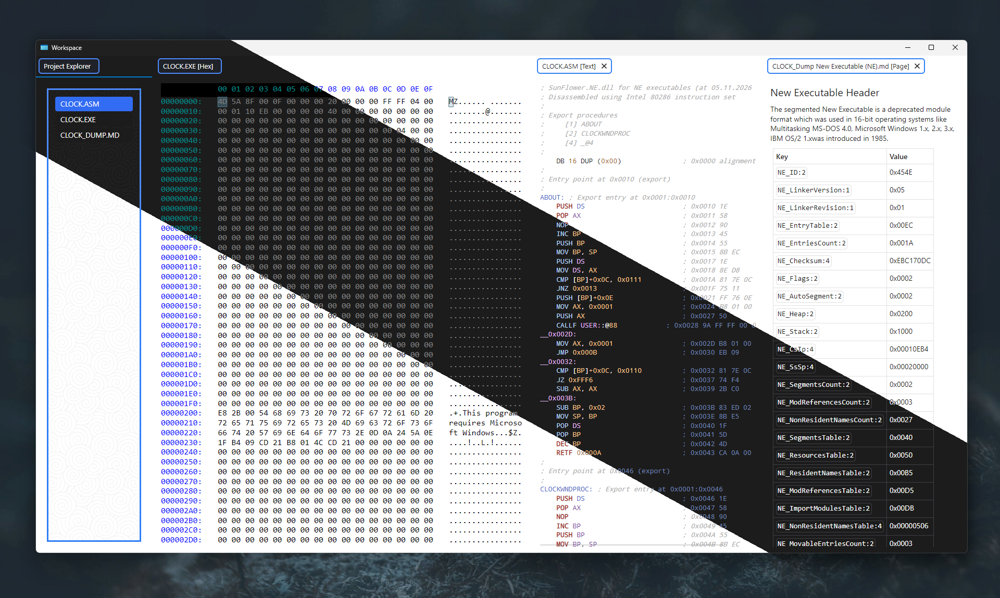
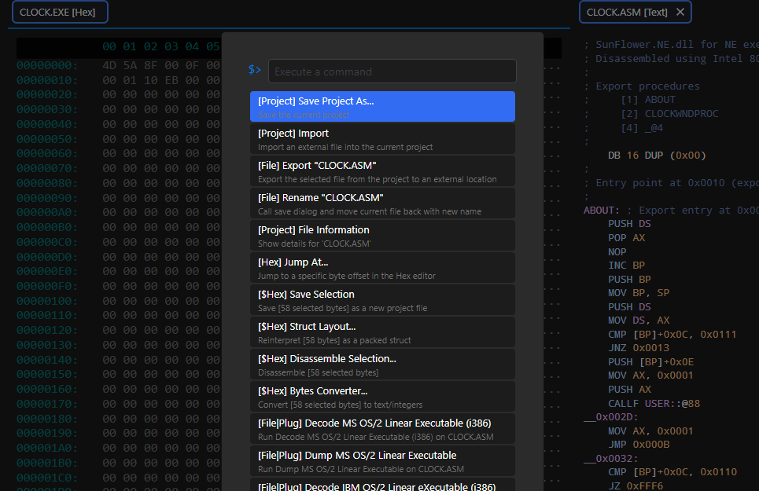
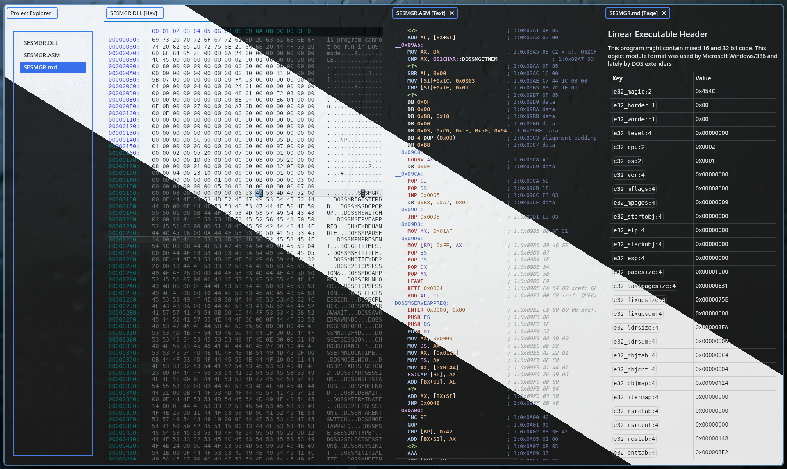

### Sunflower

Sunflower is an open-source, user-friendly, crossplatform disassembler and 
plugin-driven system designed for binary analysis.

Was inspired _by IDA, ReDasm, Binary Ninja, Ghidra, PEAnathomist, 
CFFExplrer, Semi VB Decompiler_, and other various toolkits.

Main idea was "Make a hybrid architecture and avoid any embedded functional".

This repository contains just loader details and the client. 

This repository includes following parts of my work:
 - Base definitions (`abstractions`) 
 - Plugins manager (`kernel`)
 - Avalonia client (`client`)
 - Core Disassembler (`dasm`)

> [!NOTE]
> Sources of plugins contains in [SunFlower.Plugins](https://github.com/AlexeyTolstopyatov/SunFlower.Plugins/) repository
> and not depend on this reporsitory life

### User Interface

User interface inherits completely not only Avalonia Fluent Theme.
This project was migrated from WPF where main UI decorations were in a HandyControls assembly.
The experimental `HandyControls.Avalonia` assembly was included. The controls design concept
mostly bases on handy controls, ~~In any case, I tried to follow this UI concept~~

### User Experience Concept

The second idea was a friendly user interface and the _most minimal_ user experience concept.
That's why you can't see a system/user control menu here. To operate with any project entry/user control
you should to use a command palette. 

First `[ ]`-rounded arguments tell what UI components or input are needed to execute a command. 
Shorten command arguments are means: 
 - `$` - Slice/Sized object
 - `#` - Numeric object/Quantity
 - `@` - Order/Ordinal of object 

> [!TIP]
> Command "`[$Hex]` Struct Layout" accepts an active Hex tab
> and selection of bytes in this active tab.  

### Out-of-box Sunflower Plugins

Every release of Sunflower here contains not only four core components.
In releases always will be represented plugins for definition
 - `MZ` Executables (real-mode x86 applications);
 - `NE` segmented Executables (first protected-mode x86 applications);
 - `LE` OS/2-Windows386 executables; 
 - `LX` OS/2-ArcaOS standard executables;
 - `PE` Windows NT stndard applications;
 - MS-DOS `PIF` files.
 - `A-Out` Iris/Solaris/Plan9/other Unix plain executables;
 - `ELF` Linux/BSD executables

But you sunflower gives a chance to make your own extension of it and
run it with all plugins too.

### How to make a Plugin

For making new sunflower plugin:
1) Create Visual Studio solution.
2) Add reference `SunFlower.Abstractions.dll`
3) Make sure: no differences between Client app version and Abstractions
4) Read documents at the end of "README"!
5) Build and Drop .DLL into `%Application%/Plugins`
6) Run SunFlower and see what you can!

### An architecture problems that seriously bother me, but I can't fix them

 - Versions incompatibility - Unfortunately Sunflower plugins which are differ the foundation are **incompatible**.
Any differences between foundation file version and plugins foundation calls force exit (means conflict behaviour).

### Frameworks And other external toolchain

All frameworks and toolkits
 - .NET `8.0` - Foundation of everything
 - [Avalonia XPF](https://github.com/AvaloniaUI/Avalonia) `11.3` - Foundation of crossplatform client
 - [HandyControls](https://github.com/HandyOrg/HandyControl) - better Window controls / little MVVM experience
 - [Markdown.Avalonia](https://github.com/whistyun/Markdown.Avalonia) instead of Monaco Editor and JavaScript bindings
 - [Avalonia Hex](https://github.com/Washi1337/AvaloniaHex)
 - [Avalonia Edit](https://github.com/AvaloniaUI/AvaloniaEdit)
 - [Avalonia Dock](https://github.com/wieslawsoltes/Dock)

> [!TIP]
> At the moment of publishing Sunflower the `HandyControl`s not supports
> Avalonia. In the `/external` directory exists experimental assembly of 
> HandyControls for Avalonia.

### Documents
 - [Plugins development notes (5.x)](flowerapi.md) - first stages & abstractions application
 - [Plugins develoment notes (1.x-4.x)](flowerseedapi.md) - stages & abstractions application
 - [Versioning notes](VERSIONING.md) - Which plugins/extensions are be accepted by Sunflower kernel
